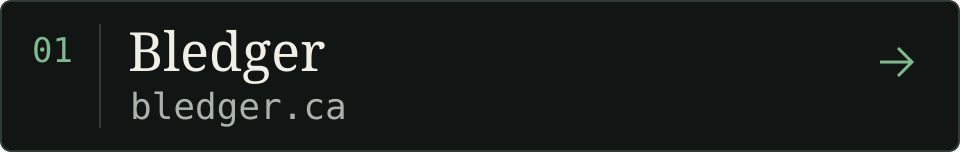
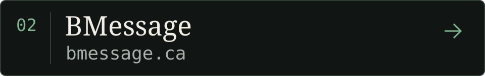
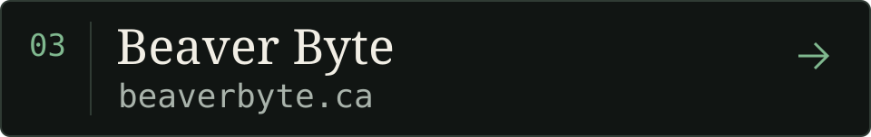
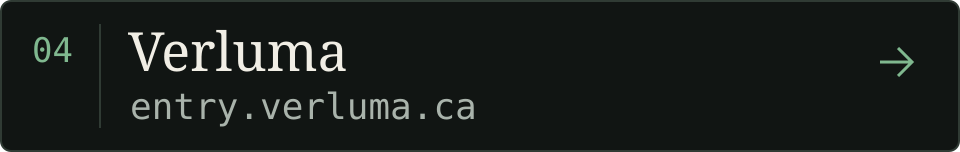

I'm **Selman**. Welcome to my little corner of the web. Based in **Toronto, Canada**. Strategy Director at **BEAVER BYTE**.

## Selected destinations

A few places to wander.

[**Bledger**](https://bledger.ca) — Tax refund and donation credit estimates for life in Canada.

[**BMessage**](https://bmessage.ca) — A small message tool with a terminal-inspired interface.

[**Beaver Byte**](https://beaverbyte.ca) — A look at web development, digital strategy, and ecommerce work.

[**Verluma**](https://entry.verluma.ca) — Verluma Entry brings receipts and transaction records together.

## Built on open source

I'm a big Linux fan, an admirer of Linus Torvalds, and someone who believes we owe a great deal to open source.

So much of what we build rests on tools that others chose to share. To the people who create, maintain, document, and improve them: thank you.

---

Say hello. [selman@beaverbyte.ca](mailto:selman@beaverbyte.ca)
