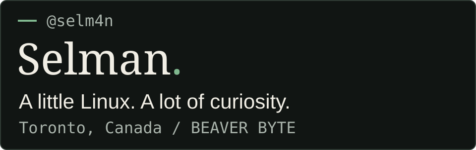

## `$ whoami`

I'm **Selman**, Strategy Director at **BEAVER BYTE**, based in **Toronto, Canada**.

**Strategy meets the command line.**

My projects span football tactics, Canadian taxes, and messaging — different problems, connected by an interest in building useful tools.

## `$ cat toolbox.txt`

**Linux · Python · Bash · Git · AWS**

From the terminal to the cloud, these are the tools in my kit.

## `$ ls projects/`

### `my11-legends`

Football tactics, mapped out. An interactive tactical board generator for exploring formations and ideas on the pitch.

### [`tax-return-app`](https://github.com/selm4n/tax-return-app)

A command-line tax simulation project for T4 employees in Ontario — applying software to tax awareness and planning.

### `b-message`

A messaging project exploring how we connect through software.

## `$ ./connect`

Have an interesting problem, a project idea, or a shared interest in Linux and building useful tools? Let's talk.

[**Send me an email**](mailto:selman@beaverbyte.ca) · [**Explore my repositories**](https://github.com/selm4n?tab=repositories)
